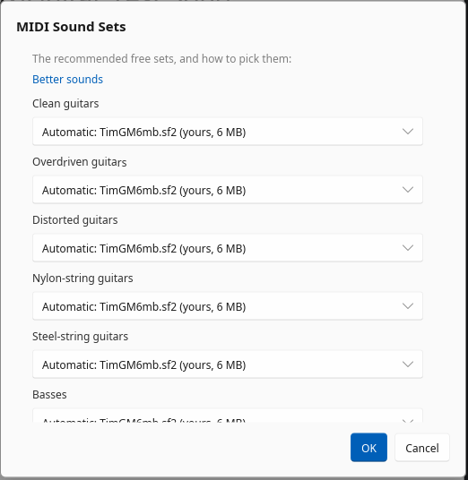

# Better sounds

OxiGuitar plays a score with sound sets you choose. This project picks one good, free instrument for each job and gives you an installer that fetches them, so you don't have to hunt. [Hear it](hear-it.md) plays the same songs with the basic system set and with these, side by side.

Each set is one instrument with no variations to choose between. Pick the set for a track and it sounds right.

The sets are not part of this repository. Each keeps its own licence and comes from its author. The installer and its scripts are GPL-3.0-or-later.

| Set | Sound | Size | Licence |
| --- | --- | --- | --- |
| `black-and-green-guitars` | Clean electric guitars | 61 MB | CC0 1.0 |
| `clean-guitar` | Clean electric guitar | 128 MB | CC0 1.0 |
| `overdriven-guitar` | Overdriven electric guitar | 136 MB | CC0 1.0 |
| `distorted-guitar` | Distorted electric guitar | 313 MB | CC0 1.0 |
| `nylon-guitar` | Nylon-string guitar | 5 MB | CC0 1.0 |
| `steel-guitar` | Steel-string acoustic guitar | 13 MB | GPL-3.0-or-later with exception |
| `ukulele` | Ukulele | 3 MB | CC0 1.0 |
| `bass` | Electric bass, plucked | 471 MB | CC0 1.0 |
| `drums` | Drum kit | 347 MB | CC BY 4.0 |

The guitars and the ukulele come from the FreePats project, the bass and the Black and Green Guitars from Karoryfer Samples, and the drum kit from DrumGizmo. Every set is credited in its own `oxiguitar-set.json`, in a `CREDITS.txt` the installer writes, and in the licence file kept with it. The drum kit's licence asks for this credit wherever the sounds are used in a published recording: Drum samples provided by DrumGizmo.org.

## Why recorded sets sound so much better

OxiGuitar's MIDI plugin turns each note into sound by playing a recording from a *sound set* ([its manual](https://mateusrdp.github.io/oxiguitar-midi/) explains how). Every computer comes with a basic General MIDI set: one small file holding 128 instruments, so each one gets only a few short recordings, stretched up and down to cover every note. It works, and it sounds like a 1990s keyboard.

The sets here are the opposite: each is **one instrument recorded in depth**. A real guitar was played string by string and fret by fret, softly and hard, sometimes several times for each note, so the plugin can pick the recording closest to what the score asks for and vary it the way a player does. The drum kit is a full kit recorded in a studio with many microphones and mixed down. The difference is easiest to hear on bends, palm mutes and drums.

The cost is size: about 1.5 GB for everything, against a few megabytes for a system set. That is why they are a separate, optional download, and why you can take only the ones you need.

## About the licences

Every set here is free to use, but "free" comes in different shapes:

- **CC0 1.0** is no conditions at all: the author gave the recordings to the public domain.
- **CC BY 4.0** (the drums) lets you do anything, as long as you credit the author. Wherever you publish something made with the drums, add: **Drum samples provided by DrumGizmo.org**.
- **GPL-3.0-or-later with an exception** (the steel-string guitar): the samples are free software, and the exception says that using them in a piece of music doesn't by itself put that music under the GPL.

Each set's licence file is installed beside it.

After installing, the MIDI plugin finds the sets by itself: each kind of track uses the matching set from the next time it plays. **Plugins → MIDI Sound Sets…** shows and changes the choice.
