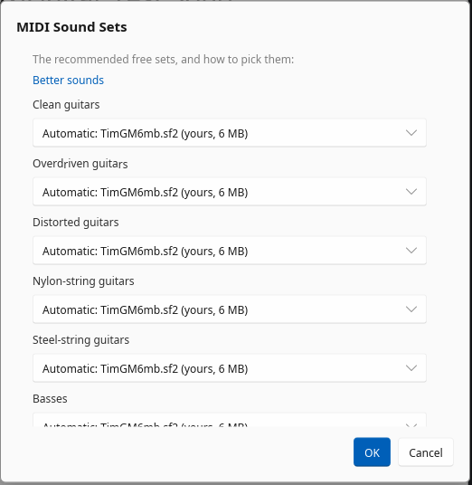

# How to use it

1. Install the sets: with the package (`oxiguitar-bettersounds-soundfonts` on Debian, Ubuntu and Fedora), or by running the installer by hand (below). The installer shows what it would download and asks first.
2. Open a song in OxiGuitar and press Play. Each kind of track picks up its matching set by itself.
3. To see or change which set plays what, choose **Plugins → MIDI Sound Sets…** in OxiGuitar:



With the sets installed, each list offers them by name (Clean Guitar, Distorted Guitar, Bass, Drums and so on) beside any other set you have. This picture shows the dialog before installing, with only the system's basic set.

## What you can do with it

- Get good sounds in one step. Install the package and it downloads the sets, or run the installer by hand on any system.
- Choose what to download. `./install.sh --list` shows what is on offer, and `--sets bass,drums` takes only those.
- Take only the recommended patch of each set, which is the one OxiGuitar plays, or every patch. Some sets hold several instruments, and all of them add about 650 MB.
- Update or remove sets. Run the installer again, and unchanged files are skipped. `--uninstall` removes what it installed.

## Running the installer by hand

You need `bash` and `curl` on Linux and macOS, or PowerShell on Windows. Download this repository as a zip, or take the zip of a release, unpack it, and run from the unpacked folder.

```sh
./install.sh --list          # what is on offer
./install.sh                 # asks which sets, then asks before downloading
./install.sh --sets bass,drums
./install.sh --yes           # every set, the recommended patch of each
./install.sh --yes --patches all
```

On Windows:

```powershell
.\install.ps1 -List
.\install.ps1
.\install.ps1 -Sets bass,drums
.\install.ps1 -Yes
```

If Windows refuses to run the script, use `powershell -ExecutionPolicy Bypass -File .\install.ps1`.

Before anything is downloaded, the installer shows each set's size, licence, author and the hosts the files come from, and waits for a yes.

## Where the sets go

| System | Folder |
| --- | --- |
| Linux | `~/.local/share/oxiguitar/soundfonts/` |
| macOS | `~/Library/Application Support/OxiGuitar/soundfonts/` |
| Windows | `%APPDATA%\OxiGuitar\soundfonts\` |
| Every user on Linux | `./install.sh --system`, into `/usr/share/oxiguitar/soundfonts/`, run as root |
| OxiGuitar's Flatpak | `~/.var/app/io.github.mateusrdp.OxiGuitar/data/oxiguitar/soundfonts/` |

The Flatpak sees only its own folders, so when it is installed the installer fills its folder too. The files there are hard links to the first copy where both folders are on one disk, so they take no extra room. `OXIGUITAR_HOME` moves OxiGuitar's whole data folder, and the installer follows it. `--dir DIR` picks any other folder.

Each set gets its own folder holding the instrument, its samples, its licence and an `oxiguitar-set.json` that tells OxiGuitar what the set is and which row it is made for. OxiGuitar then uses each set by itself from the next time it plays. Picking another set for a row in the MIDI plugin's dialog always wins.
